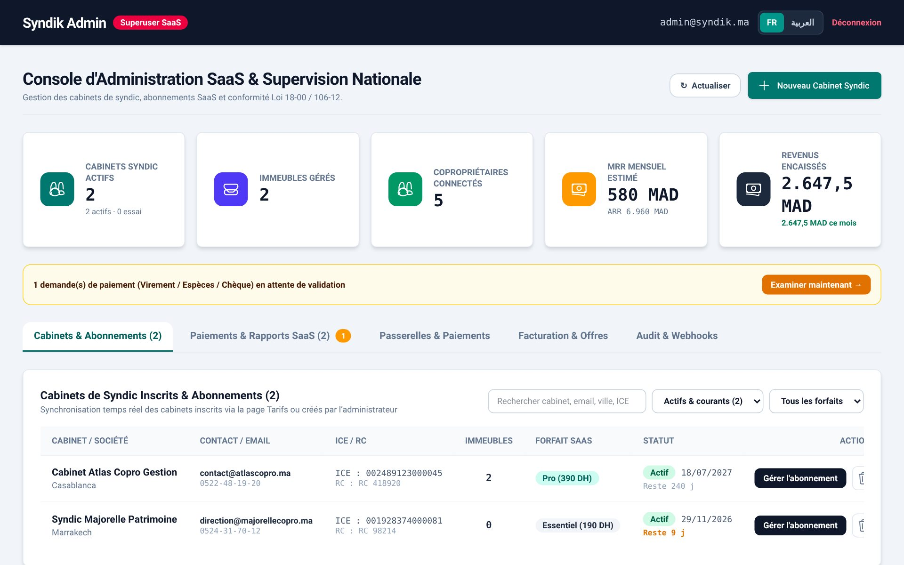
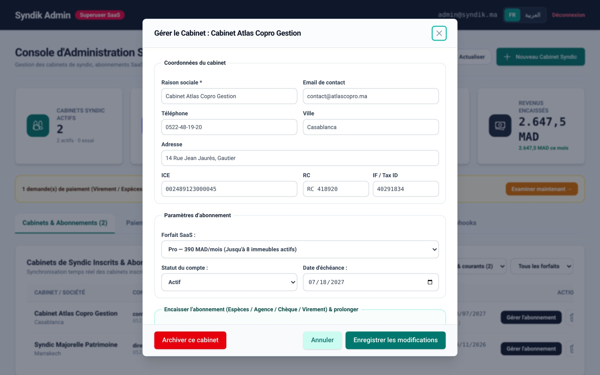
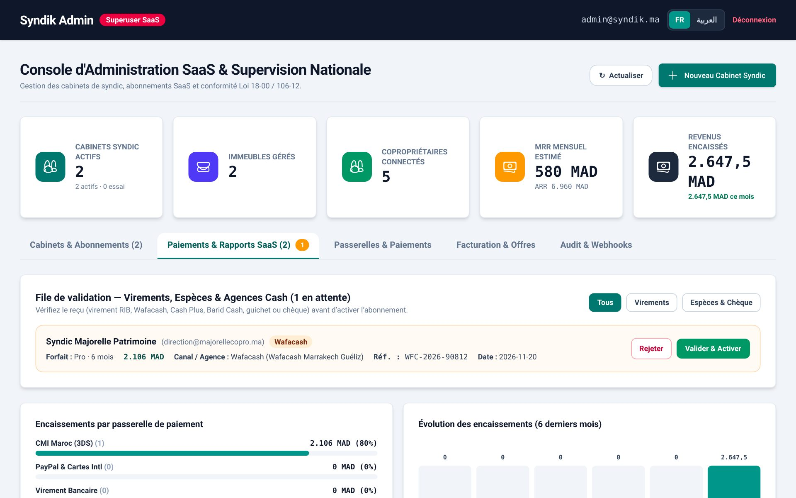
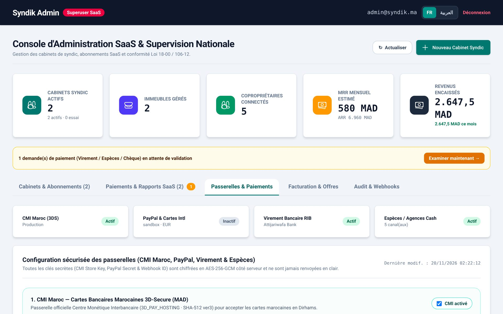
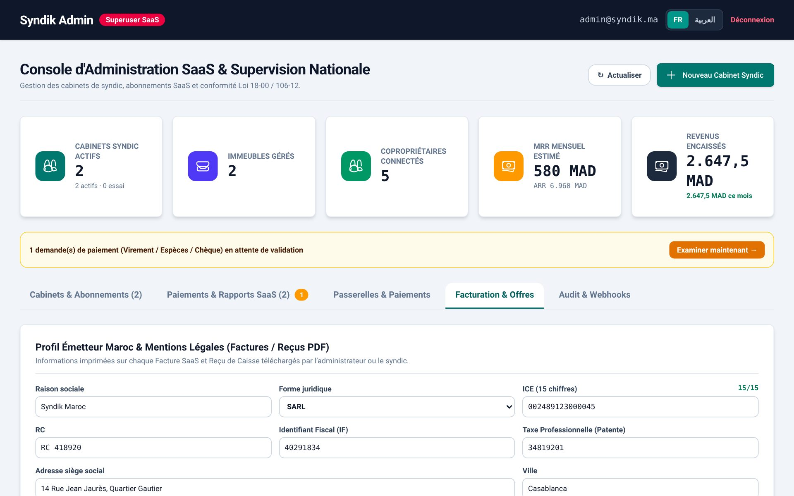
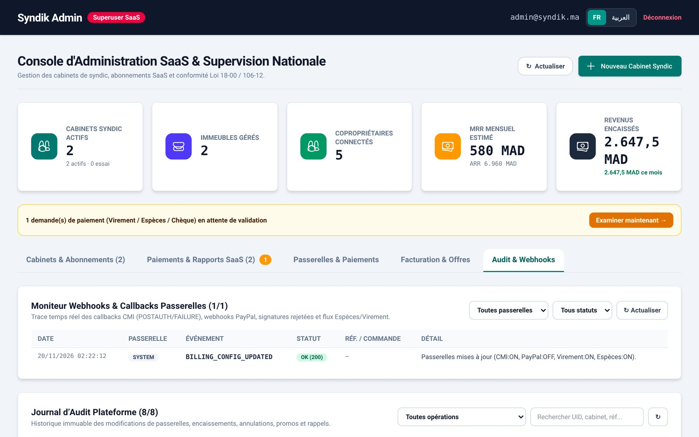

<!-- AUTO-GENERATED by npm run docs:guides from data/userGuides/ — DO NOT EDIT MANUALLY -->
# Guide d’Utilisation — Super-Admin SaaS
> **AR :** دليل الاستخدام — الإدارة العامة للمنصة

Cabinets syndics, passerelles CMI/PayPal/RIB/Espèces, profil fiscal, codes promo et audit.

## Sommaire

1. [Gérer les Cabinets Syndics, Encaissements Guichet & Rappels](#1-gerer-les-cabinets-syndics-encaissements-guichet-rappels)
2. [Rapports SaaS, Répartition Passerelles & File de Validation Hors-Ligne](#2-rapports-saas-repartition-passerelles-file-de-validation-hors-ligne)
3. [Configurer CMI Maroc 3DS, PayPal, Virement RIB & Agences Cash](#3-configurer-cmi-maroc-3ds-paypal-virement-rib-agences-cash)
4. [Profil Fiscal Émetteur (ICE/TVA), Remises Multi-Mois, Grâce & Codes Promo](#4-profil-fiscal-emetteur-ice-tva-remises-multi-mois-grace-codes-promo)
5. [Surveiller les Webhooks CMI/PayPal & le Journal d’Audit Plateforme](#5-surveiller-les-webhooks-cmi-paypal-le-journal-d-audit-plateforme)

---

## 1. Gérer les Cabinets Syndics, Encaissements Guichet & Rappels
> **AR:** إدارة مكاتب السنديك، التحصيل النقدي بالشباك والتنبيهات

**Catégorie :** Supervision Cabinets · **Durée estimée :** ~4 min

Créez et pilotez les cabinets inscrits sur la plateforme, suivez les KPIs MRR/ARR et périodes de grâce, encaissez au guichet (Espèces, Wafacash, Chèque) et envoyez des rappels d’échéance.

### Étapes pas à pas

#### Étape 1 — Lire les KPIs globaux et filtrer les cabinets par statut ou forfait

En haut de la console Super-Admin, suivez le nombre de cabinets actifs, d’immeubles gérés, le MRR mensuel, l’ARR annuel et les revenus encaissés. Utilisez la barre de recherche (nom, email, ville, ICE) et les filtres de statut (Actifs, En essai, Expirés, Suspendus, Archivés).

*Vue Cabinets : KPIs nationaux (MRR, ARR, Encaissés), alertes d’échéance avec bouton Rappel 1-clic et tableau des cabinets.*

#### Étape 2 — Encaisser un abonnement au guichet (Espèces / Agence / Chèque) & télécharger le Reçu PDF

Cliquez sur « Gérer l’abonnement » sur la ligne d’un cabinet. Dans la section « Encaisser l’abonnement », choisissez la durée (1, 3, 6 ou 12 mois), le mode (Espèces, Wafacash, Cash Plus, Barid Cash, Chèque, Virement), cliquez sur « Auto-générer » pour créer une référence unique, ajoutez un code promo éventuel puis cliquez sur « Encaisser & Prolonger ». Le bouton « Télécharger Reçu / Facture PDF » apparaît immédiatement.

> **Astuce :** En cas d’erreur, cliquez sur « Annuler » dans l’historique du cabinet : la facture passe en Avoir (DOCUMENT ANNULE / AVOIR), l’usage du code promo est restauré et la date d’échéance précédente est rétablie.

*Modal Gérer le Cabinet : édition ICE/RC/IF, encaissement guichet multi-canaux, historique et téléchargement PDF.*

#### Étape 3 — Envoyer un rappel de renouvellement en 1 clic

Pour les cabinets arrivant à échéance (≤ 15 jours) ou en période de grâce, utilisez le bouton « Rappel » dans l’encart d’alerte. Une notification interne est immédiatement envoyée au portail du Syndic, complétée par un email si la messagerie SMTP/SendGrid est configurée.

---

## 2. Rapports SaaS, Répartition Passerelles & File de Validation Hors-Ligne
> **AR:** التقارير المالية، توزيع بوابات الدفع وطلبات المصادقة

**Catégorie :** Revenus & Validation · **Durée estimée :** ~3 min

Analysez les encaissements par passerelle (CMI, PayPal, Virement, Espèces, Chèque), suivez la tendance sur 6 mois, validez les justificatifs soumis par les syndics et exportez le journal comptable CSV/PDF.

### Étapes pas à pas

#### Étape 1 — Suivre les encaissements par passerelle et la tendance 6 mois

Ouvrez l’onglet « Paiements & Rapports SaaS ». Les deux panneaux analytiques détaillent le chiffre d’affaires par mode de règlement (CMI 3DS, PayPal, Virement, Espèces/Agences, Chèque) ainsi que l’évolution mensuelle sur les 6 derniers mois.

*Rapports SaaS : ventilation par passerelle, courbe 6 mois, file unifiée Virement/Espèces et registre des factures PDF.*

#### Étape 2 — Valider ou rejeter une demande Virement / Espèces / Agence / Chèque

Filtrez la file d’attente (Tous, Virements RIB, Espèces & Chèques), cliquez sur « Voir justificatif » pour contrôler le reçu bancaire ou d’agence, puis cliquez sur « Valider & Activer » (crée automatiquement la facture numérotée et prolonge le cabinet) ou « Rejeter » avec un motif précis.

#### Étape 3 — Télécharger une Facture PDF ou exporter le CSV comptable

Dans le registre des paiements, filtrez par méthode ou référence, téléchargez la Facture / Reçu PDF officielle sur chaque ligne, ou cliquez sur « Exporter CSV » pour votre cabinet comptable.

---

## 3. Configurer CMI Maroc 3DS, PayPal, Virement RIB & Agences Cash
> **AR:** إعداد CMI المغرب 3DS و PayPal والتحويل البنكي ووكالات النقد

**Catégorie :** Passerelles de Paiement · **Durée estimée :** ~5 min

Activez et sécurisez les 4 moyens de règlement proposés aux syndics : carte marocaine CMI 3D-Secure, PayPal international, virement bancaire RIB et dépôt espèces/agences (Wafacash, Cash Plus, Barid Cash, Bureau, Chèque).

### Étapes pas à pas

#### Étape 1 — Vérifier le bandeau d’état des passerelles (Readiness Strip)

En haut de l’onglet « Passerelles & Paiements », vérifiez l’état de chaque passerelle et les avertissements de sécurité (ex. PayPal Live sans Webhook ID ou Store Key CMI manquante).

*Configuration centralisée : CMI Maroc (SHA-512), PayPal chiffré, validation RIB/IBAN/SWIFT/ICE et canaux Espèces/Agences.*

#### Étape 2 — Paramétrer CMI Maroc 3D-Secure (ver3 SHA-512)

Saisissez votre Client ID CMI, votre Store Key secrète (chiffrée AES-256-GCM en base et masquée après sauvegarde), choisissez l’environnement (Test / Production) et la devise (504 MAD). Copiez les URLs « Callback Server-to-Server » et « Retour Navigateur » pour les communiquer au CMI, puis lancez « Tester CMI (SHA-512) ».

#### Étape 3 — Sécuriser PayPal, Virement RIB et Espèces / Agences (Wafacash, Cash Plus, Barid Cash)

Pour PayPal en mode Live, renseignez impérativement le Webhook ID officiel. Pour le Virement Maroc, saisissez le RIB 24 chiffres (formatage et contrôle IBAN/SWIFT/ICE en direct). Pour Espèces/Agences, cochez les canaux acceptés, renseignez le bénéficiaire, l’adresse, les horaires, le plafond espèces CGI (5 000 MAD par défaut) et l’exigence de justificatif, puis cliquez sur « Enregistrer ».

> **Conformité Maroc (Loi 18-00 / CGI) :** Conformité CGI Maroc : le plafond espèces par défaut (5 000 MAD) évite les règlements en numéraire au-delà du seuil légal déductible ; au-delà, le syndic est orienté vers Chèque, Virement RIB ou CMI.

---

## 4. Profil Fiscal Émetteur (ICE/TVA), Remises Multi-Mois, Grâce & Codes Promo
> **AR:** الملف الضريبي (ICE/TVA)، خصومات المدة، فترة السماح والرموز الترويجية

**Catégorie :** Facturation & Offres · **Durée estimée :** ~3 min

Configurez les mentions légales marocaines de vos factures PDF, les remises 3/6/12 mois, la période de grâce post-échéance (0–30 jours) et vos campagnes de codes promo.

### Étapes pas à pas

#### Étape 1 — Compléter le Profil Émetteur Maroc & le régime TVA (0% ou 20%)

Dans l’onglet « Facturation & Offres », renseignez la raison sociale, forme juridique (SARL, SARL AU, SA, Auto-Entrepreneur), ICE (15 chiffres), RC, IF, Patente, CNSS, préfixes de numérotation (FAC / REC) et taux de TVA (0% ou 20%). Toutes les factures et reçus PDF générés reprennent immédiatement ces mentions.

*Profil fiscal Maroc (ICE/RC/IF/TVA), aperçu tarifaire 6m/12m, période de grâce et tableau CRUD des codes promo.*

#### Étape 2 — Régler les remises multi-mois et la période de grâce post-échéance

Définissez vos pourcentages de remise pour 3, 6 et 12 mois (aperçu tarifaire calculé en direct) et la période de grâce (0 à 30 jours) pendant laquelle un cabinet échu garde ses droits d’écriture avec une bannière d’alerte ambre.

#### Étape 3 — Créer, activer ou désactiver des codes promotionnels

Créez un code (ex. BIENVENUE20 ou RAMADAN100) en pourcentage ou montant fixe MAD, limitez-le éventuellement à certains forfaits, à une durée minimale, à une date d’expiration ou à un nombre maximal d’utilisations. Les codes sont utilisables sur CMI, PayPal, Virement, Espèces et guichet.

---

## 5. Surveiller les Webhooks CMI/PayPal & le Journal d’Audit Plateforme
> **AR:** مراقبة Webhooks لبوابات CMI/PayPal وسجل تدقيق المنصة

**Catégorie :** Audit & Cadre Légal · **Durée estimée :** ~2 min

Contrôlez en temps réel chaque callback CMI, webhook PayPal et action sensible réalisée sur la console d’administration.

### Étapes pas à pas

#### Étape 1 — Filtrer le Moniteur Webhooks & Callbacks Passerelles

Ouvrez l’onglet « Audit & Webhooks ». Filtrez par passerelle (CMI, PayPal, Virement, Espèces, Système) et par statut (Succès, Erreur, Rejeté) pour diagnostiquer instantanément un échec de signature, un remboursement ou un paiement capturé.

*Traçabilité complète : callbacks CMI/PayPal horodatés et journal d’audit filtrable par opération ou recherche texte.*

#### Étape 2 — Rechercher une opération dans le Journal d’Audit Plateforme

Utilisez la recherche libre ou le filtre d’opération (modifications de passerelles, encaissements, annulations, promos, rappels) pour vérifier qui a exécuté quelle action et à quelle heure.

#### Étape 3 — Mettre à jour le Cadre Légal sans redéploiement (effet prospectif)

Depuis l’onglet « Cadre Légal », ajustez en français et en arabe les références légales officielles ainsi que les seuils réglementaires (taux par défaut du fonds de réserve pour les nouveaux immeubles, plafond de procurations AG, délais de convocation et de mise en demeure). Les quittances et PV déjà émis conservent leur mention légale d’origine.

---
