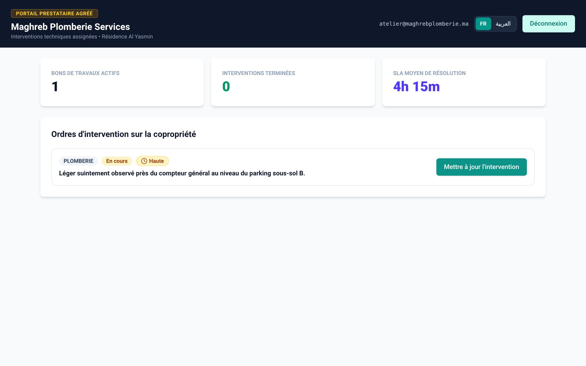
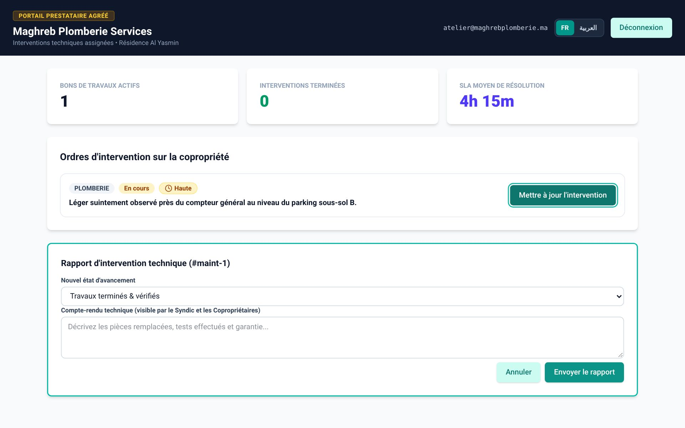

<!-- AUTO-GENERATED by npm run docs:guides from data/userGuides/ — DO NOT EDIT MANUALLY -->
# Guide d’Utilisation — Prestataire Agréé
> **AR :** دليل الاستخدام — مقدم الخدمة المعتمد

Activation du compte partenaire, suivi des bons d’intervention, notes techniques et clôture.

## Sommaire

1. [Activer son Compte Prestataire & Consulter la Résidence](#1-activer-son-compte-prestataire-consulter-la-residence)
2. [Prendre en Charge un Bon d’Intervention (En cours → Terminé)](#2-prendre-en-charge-un-bon-d-intervention-en-cours-termine)
3. [Rédiger un Compte-Rendu Technique & Clôturer l’Intervention](#3-rediger-un-compte-rendu-technique-cloturer-l-intervention)

---

## 1. Activer son Compte Prestataire & Consulter la Résidence
> **AR:** تفعيل حساب مقدم الخدمة المعتمد والاطلاع على الإقامة

**Catégorie :** Démarrage Prestataire · **Durée estimée :** ~2 min

Connectez-vous pour la première fois à votre portail Prestataire Agréé à l’aide de la fiche d’accès remise par le Syndic et consultez vos interventions assignées.

### Prérequis
- Avoir reçu votre Fiche d’Accès PDF (Email professionnel + Mot de passe temporaire) de la part du Syndic.

### Étapes pas à pas

#### Étape 1 — Se connecter sur la page /login et sécuriser son mot de passe

Ouvrez le portail sur /login, saisissez l’email professionnel et le mot de passe temporaire indiqués sur votre fiche. À la première connexion, choisissez immédiatement un mot de passe personnel d’au moins 10 caractères.

> **Astuce :** Votre compte est strictement isolé : vous ne voyez que les tickets qui vous sont assignés ou qui relèvent de votre spécialité.

#### Étape 2 — Consulter la liste des bons d’intervention assignés

Depuis le tableau de bord Prestataire, repérez le nom de la résidence, le niveau d’urgence (Urgence, Haute, Moyenne, Basse), la catégorie technique et la description du problème.

*Portail Prestataire : badges de priorité, résidence rattachée et liste filtrée de vos bons d’intervention.*

### Questions fréquentes

- **Pourquoi je ne vois pas les documents comptables ou les AG de l’immeuble ?** — Par conformité et confidentialité, le portail Prestataire donne accès uniquement aux bons d’intervention techniques qui vous concernent.

---

## 2. Prendre en Charge un Bon d’Intervention (En cours → Terminé)
> **AR:** معالجة أمر التدخل وتحديث حالته (قيد الإنجاز ← مكتمل)

**Catégorie :** Interventions Techniques · **Durée estimée :** ~3 min

Mettez à jour l’avancement d’une panne en temps réel pour informer le Syndic et le copropriétaire concerné.

### Étapes pas à pas

#### Étape 1 — Ouvrir le formulaire de mise à jour sur un ticket actif

Cliquez sur le bouton « Mettre à jour / Intervenir » sur la carte du bon d’intervention concerné. Le panneau technique s’ouvre directement dans la carte.

*Mise à jour directe du statut (En cours ou Intervention terminée) avec compte-rendu technique horodaté.*

#### Étape 2 — Passer le statut à « En cours » dès le début des travaux

Sélectionnez « En cours » pour indiquer votre prise en charge (diagnostic effectué, pièce commandée ou technicien sur place), saisissez une note claire et enregistrez.

> **Astuce :** Chaque mise à jour envoie automatiquement une notification au Syndic et au résident déclarant.

---

## 3. Rédiger un Compte-Rendu Technique & Clôturer l’Intervention
> **AR:** كتابة التقرير التقني وإغلاق التدخل

**Catégorie :** Clôture & Traçabilité · **Durée estimée :** ~2 min

Documentez les travaux réalisés et clôturez proprement le bon d’intervention pour déclencher la validation du Syndic.

### Étapes pas à pas

#### Étape 1 — Décrire précisément les pièces remplacées et les tests effectués

Dans le champ « Compte-rendu technique », indiquez la cause identifiée, les pièces changées, la durée et la date de remise en service. Ce journal reste archivé dans l’historique de l’immeuble.

#### Étape 2 — Sélectionner « Terminé / Clôturer » et valider

Une fois la réparation vérifiée, choisissez le statut « Terminé » et validez. Le ticket est alors verrouillé contre toute modification accidentelle : seul le Syndic peut le rouvrir si nécessaire.

### Questions fréquentes

- **Que faire si je dois revenir sur un ticket déjà marqué Terminé ?** — Contactez le Syndic de la résidence : lui seul dispose du droit de réouverture d’un ticket clôturé pour garantir l’intégrité du suivi.

---
