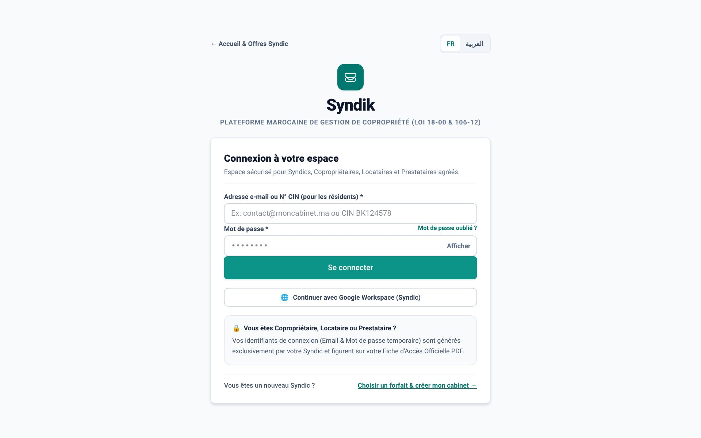
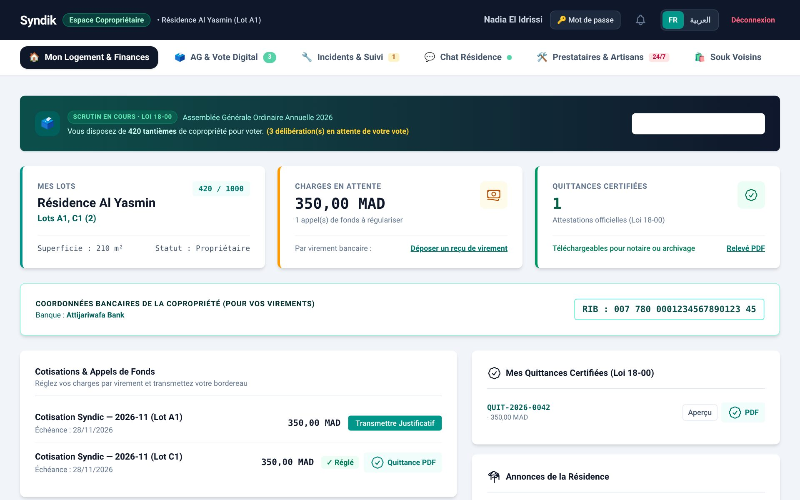
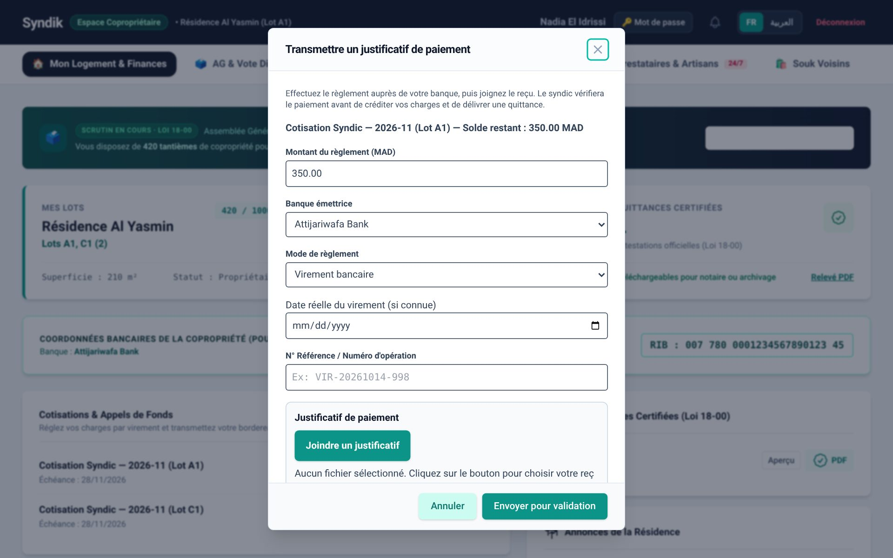
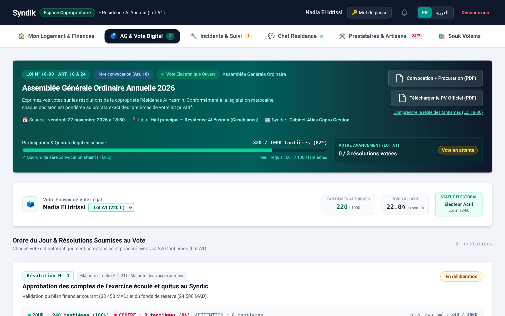
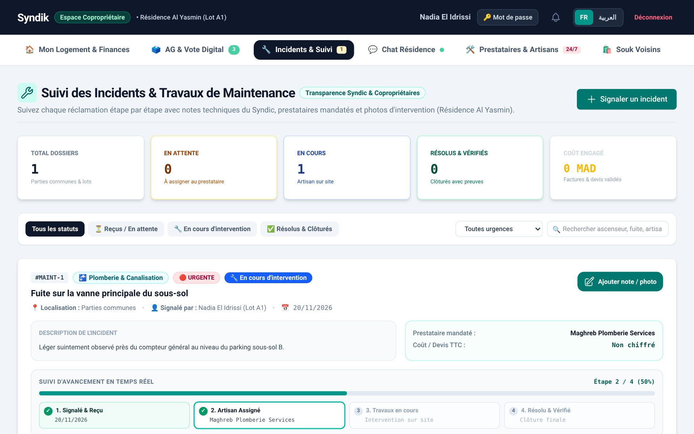
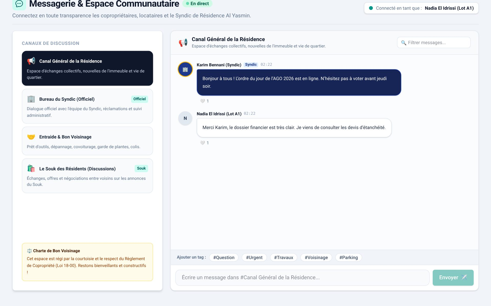
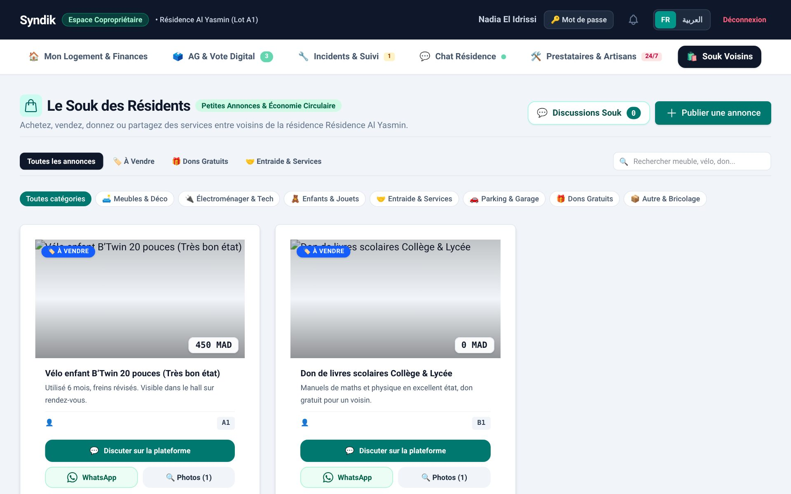

<!-- AUTO-GENERATED by npm run docs:guides from data/userGuides/ — DO NOT EDIT MANUALLY -->
# Guide d’Utilisation — Copropriétaire & Locataire
> **AR :** دليل الاستخدام — المالك المشترك والمكتري

Charges, envoi de justificatifs, quittances PDF, vote en ligne AG, incidents, messagerie et Le Souk.

## Sommaire

1. [Première Connexion Sécurisée & Changement de Mot de Passe](#1-premiere-connexion-securisee-changement-de-mot-de-passe)
2. [Consulter mes Charges, Envoyer un Justificatif & Télécharger mes Quittances PDF](#2-consulter-mes-charges-envoyer-un-justificatif-telecharger-mes-quittances-pdf)
3. [Voter en Ligne aux Assemblées Générales (Pondération Tantièmes & Multi-Lots)](#3-voter-en-ligne-aux-assemblees-generales-ponderation-tantiemes-multi-lots)
4. [Signaler un Incident avec Photos & Suivre la Réparation](#4-signaler-un-incident-avec-photos-suivre-la-reparation)
5. [Consulter les Prestataires Agréés & Laisser un Avis](#5-consulter-les-prestataires-agrees-laisser-un-avis)
6. [Messagerie d’Entraide, Annonces & Documents Officiels](#6-messagerie-d-entraide-annonces-documents-officiels)
7. [Publier & Échanger sur Le Souk de la Résidence](#7-publier-echanger-sur-le-souk-de-la-residence)

---

## 1. Première Connexion Sécurisée & Changement de Mot de Passe
> **AR:** أول تسجيل دخول آمن وتغيير كلمة المرور

**Catégorie :** Accès & Sécurité · **Durée estimée :** ~2 min

Activez votre espace Copropriétaire ou Locataire avec la fiche d’accès remise par votre Syndic et définissez votre mot de passe personnel confidentiel.

### Prérequis
- Avoir reçu la Fiche d’Identifiants PDF (Email ou N° CIN + Mot de passe temporaire) de votre Syndic.

### Étapes pas à pas

#### Étape 1 — Ouvrir /login et saisir votre email (ou CIN) et mot de passe temporaire

Rendez-vous sur la page de connexion, sélectionnez l’onglet « Connexion », puis saisissez l’identifiant (email ou CIN) et le mot de passe temporaire figurant sur votre fiche d’accès.

*Page de connexion unique : accès Syndic, Copropriétaire, Locataire et Prestataire Agréé.*

#### Étape 2 — Définir un mot de passe personnel (minimum 10 caractères)

Lors de votre première connexion, un écran de sécurité vous demande obligatoirement de choisir un nouveau mot de passe personnel différent du code temporaire. Une fois validé, vous accédez immédiatement à votre portail.

---

## 2. Consulter mes Charges, Envoyer un Justificatif & Télécharger mes Quittances PDF
> **AR:** الاطلاع على واجباتي، إرسال وصل الأداء وتحميل التوصيلات PDF

**Catégorie :** Charges & Quittances · **Durée estimée :** ~3 min

Suivez votre solde en temps réel, envoyez votre justificatif de virement bancaire au Syndic et téléchargez à tout moment vos quittances officielles de copropriété (Loi 18-00).

### Étapes pas à pas

#### Étape 1 — Consulter le solde, les appels de charges et les quittances

Depuis l’onglet « Aperçu / Mes Charges », visualisez votre solde global, vos appels mensuels ou appels travaux (impayés, partiels ou payés) ainsi que la section « Mes Quittances Officielles » avec téléchargement PDF en 1 clic.

*Vue Copropriétaire : situation du lot, appels de charges, bouton « Payer / Envoyer reçu » et quittances PDF.*

#### Étape 2 — Déclarer un virement ou dépôt et joindre le reçu bancaire

Cliquez sur « Payer / Envoyer justificatif » sur un appel de charges. Copiez le RIB 24 chiffres de la copropriété, saisissez la référence de votre virement, la banque, la date et importez la photo ou le PDF du reçu. Le Syndic le valide en 1 clic et votre quittance PDF est générée automatiquement.

*Déclaration de virement avec RIB officiel de la copropriété et téléversement sécurisé du justificatif.*

> **Conformité Maroc (Loi 18-00 / CGI) :** Chaque quittance générée après validation comporte le numéro séquentiel officiel, les références de la copropriété, le montant en chiffres et en toutes lettres (conforme Loi 18-00).

---

## 3. Voter en Ligne aux Assemblées Générales (Pondération Tantièmes & Multi-Lots)
> **AR:** التصويت الإلكتروني في الجمع العام (حسب الأنصبة وتعدد الشقق)

**Catégorie :** Assemblées Générales · **Durée estimée :** ~3 min

Exercez votre droit de vote de copropriétaire sur chaque résolution de l’AGO/AGE : votre voix est pondérée automatiquement selon les tantièmes officiels de chacun de vos lots.

### Prérequis
- Être enregistré en tant que Copropriétaire Titulaire (les locataires ne participent pas au vote AG selon la Loi 18-00).
- Une Assemblée Générale doit être ouverte au vote par le Syndic.

### Étapes pas à pas

#### Étape 1 — Ouvrir l’onglet « Vote AG » et consulter l’ordre du jour

Dans l’onglet « Vote AG », consultez la date de l’assemblée, la règle de majorité requise pour chaque résolution (Art. 21, Art. 22 ou Unanimité) ainsi que le détail budgétaire éventuel.

*Vote pondéré par tantièmes : choix Pour / Contre / Abstention avec commentaire ou réserve consignée au PV.*

#### Étape 2 — Voter Pour, Contre ou Abstention (lot par lot si multi-propriétaire)

Si vous possédez plusieurs lots dans la résidence, sélectionnez le lot concerné puis cliquez sur Pour, Contre ou Abstention. Vous pouvez ajouter une réserve écrite qui figurera dans le Procès-Verbal officiel (Art. 16-10).

> **Astuce :** Pendant que le scrutin est ouvert, les votes individuels des autres copropriétaires restent confidentiels ; le détail complet est publié à la clôture du PV.

---

## 4. Signaler un Incident avec Photos & Suivre la Réparation
> **AR:** التبليغ عن عطب بالصور وتتبع مراحل الإصلاح

**Catégorie :** Maintenance & Dépannages · **Durée estimée :** ~2 min

Déclarez une panne dans les parties communes ou votre lot en joignant une photo, puis suivez chaque étape d’intervention jusqu’à la résolution.

### Étapes pas à pas

#### Étape 1 — Créer une déclaration d’incident depuis l’onglet Maintenance

Cliquez sur l’onglet « Maintenance » puis sur « Signaler un incident ». Choisissez la catégorie (Plomberie, Électricité, Ascenseur, Parties communes…), le degré d’urgence, précisez si cela concerne votre lot ou les parties communes, ajoutez une photo et envoyez.

*Suivi transparent : statut en temps réel (En attente, En cours, Terminé), prestataire affecté et journal des étapes.*

#### Étape 2 — Suivre la chronologie d’intervention

Chaque mise à jour effectuée par le Syndic ou le prestataire agréé apparaît dans la chronologie du ticket et déclenche une notification dans la cloche en haut de votre écran.

---

## 5. Consulter les Prestataires Agréés & Laisser un Avis
> **AR:** الاطلاع على الحرفيين المعتمدين وتقييم خدماتهم

**Catégorie :** Prestataires Agréés · **Durée estimée :** ~2 min

Accédez aux coordonnées des artisans vérifiés par votre Syndic (plombier, électricien, ascensoriste…) et partagez un avis objectif après intervention.

### Étapes pas à pas

#### Étape 1 — Filtrer l’annuaire par spécialité et contacter un prestataire

Ouvrez l’onglet « Prestataires ». Filtrez par spécialité pour retrouver le numéro d’astreinte, le responsable technique et la note moyenne attribuée par les voisins.

*Annuaire vérifié par le Syndic avec spécialités, contacts directs et système d’avis limité à 1 avis par résident.*

#### Étape 2 — Noter une intervention (1 à 5 étoiles)

Cliquez sur « Laisser un avis », choisissez une note entre 1 et 5 étoiles et ajoutez un bref retour d’expérience utile pour les autres habitants.

---

## 6. Messagerie d’Entraide, Annonces & Documents Officiels
> **AR:** المحادثات الجماعية، الإعلانات الرسمية والوثائق

**Catégorie :** Vie de Résidence & Documents · **Durée estimée :** ~2 min

Échangez avec vos voisins dans les canaux dédiés (Général, Entraide, Alertes), lisez les annonces urgentes du Syndic et consultez les PV et règlements.

### Étapes pas à pas

#### Étape 1 — Participer aux canaux de discussion de l’immeuble

Dans l’onglet « Messagerie », sélectionnez le canal approprié (Général, Entraide voisins, Sécurité / Alertes) pour poser une question, signaler un colis ou partager une information utile.

*Messagerie interne organisée par canaux thématiques avec réactions et modération par le Syndic.*

#### Étape 2 — Télécharger les documents officiels (Règlement, PV AG, Assurances)

Depuis l’onglet « Aperçu », accédez à la bibliothèque des documents autorisés pour votre profil (les documents réservés aux propriétaires ne sont visibles que par les titulaires de lots).

---

## 7. Publier & Échanger sur Le Souk de la Résidence
> **AR:** النشر والبيع والتبادل في سوق الإقامة

**Catégorie :** Le Souk de la Résidence · **Durée estimée :** ~2 min

Vendez, donnez ou proposez un service de proximité entre voisins de confiance au sein de votre immeuble avec messagerie privée sécurisée.

### Étapes pas à pas

#### Étape 1 — Publier une annonce (Vente, Don gratuit ou Service)

Ouvrez l’onglet « Le Souk », cliquez sur « Publier une annonce », renseignez le titre, la catégorie, le prix en MAD (0 MAD pour un don gratuit), ajoutez une photo et publiez.

*Le Souk privé de la résidence : filtres par catégorie, prix en MAD et messagerie directe avec le vendeur.*

#### Étape 2 — Contacter un voisin en message privé et marquer comme Vendu

Cliquez sur « Contacter » sur une annonce pour ouvrir un fil de discussion privé entre vous et l’auteur (invisible dans le chat public). Une fois l’objet cédé, marquez votre annonce « Vendu / Clôturé ».

---
