<!-- AUTO-GENERATED by npm run docs:guides from data/userGuides/ — DO NOT EDIT MANUALLY -->
# Guide d’Utilisation — Syndic Gestionnaire
> **AR :** دليل الاستخدام — وكيل الاتحاد (السنديك)

Immeubles, lots & tantièmes, comptabilité syndic, AG, maintenance, documents et abonnement SaaS.

## Sommaire

1. [Démarrage Rapide d’un Cabinet Syndic (Checklist de Conformité)](#1-demarrage-rapide-d-un-cabinet-syndic-checklist-de-conformite)
2. [Gérer les Immeubles, Coordonnées Bancaires RIB & Capacité Forfait](#2-gerer-les-immeubles-coordonnees-bancaires-rib-capacite-forfait)
3. [Lire le Tableau de Bord & KPIs de la Résidence](#3-lire-le-tableau-de-bord-kpis-de-la-residence)
4. [Lots, Appartements & Répartition des Tantièmes (1000/1000)](#4-lots-appartements-repartition-des-tantiemes-1000-1000)
5. [Résidents, Copropriétaires & Fiches d’Accès PDF](#5-residents-coproprietaires-fiches-d-acces-pdf)
6. [Appels de Fonds, Cotisations Mensuelles & Soldes Initiaux](#6-appels-de-fonds-cotisations-mensuelles-soldes-initiaux)
7. [Virements à vérifier, Rapprochement CSV & Reçus (quittances)](#7-virements-a-verifier-rapprochement-csv-recus-quittances)
8. [Enregistrer une dépense, Fonds de réserve & Historique](#8-enregistrer-une-depense-fonds-de-reserve-historique)
9. [Assemblées Générales (AGO/AGE), Convocations, Quorum & PV PDF](#9-assemblees-generales-ago-age-convocations-quorum-pv-pdf)
10. [Suivi des Incidents, Priorités & Affectation Prestataire](#10-suivi-des-incidents-priorites-affectation-prestataire)
11. [Annuaire Prestataires Agréés (ICE/RC/RIB) & Fiches d’Accès](#11-annuaire-prestataires-agrees-ice-rc-rib-fiches-d-acces)
12. [Coffre-fort Documents & Contrôle de Visibilité](#12-coffre-fort-documents-controle-de-visibilite)
13. [Annonces Officielles & Modération de la Messagerie](#13-annonces-officielles-moderation-de-la-messagerie)
14. [Modérer Le Souk de la Résidence](#14-moderer-le-souk-de-la-residence)
15. [Paramètres Cabinet, Rapports & Renouvellement SaaS (CMI, PayPal, RIB, Espèces & Factures PDF)](#15-parametres-cabinet-rapports-renouvellement-saas-cmi-paypal-rib-especes-factures-pdf)

---

## 1. Démarrage Rapide d’un Cabinet Syndic (Checklist de Conformité)
> **AR:** الانطلاق السريع لمكتب السنديك (قائمة الجاهزية القانونية)

**Catégorie :** Démarrage & Conformité · **Durée estimée :** ~4 min

Suivez ces 5 étapes dans l’ordre lors de la reprise ou création d’une résidence pour obtenir une comptabilité exacte, des votes pondérés conformes et des portails résidents prêts en moins de 15 minutes.

### Étapes pas à pas

#### Étape 1 — 1. Créer la résidence et renseigner son RIB bancaire (24 chiffres)

Ouvrez « Immeubles & Résidences » et créez votre résidence avec son adresse complète, sa ville, sa cotisation mensuelle par défaut et le RIB 24 chiffres du compte bancaire dédié de la copropriété.

#### Étape 2 — 2. Structurer les lots et équilibrer les tantièmes à 1000/1000

Dans « Lots & Appartements », créez tous les appartements/commerces (individuellement ou en lot) puis ajustez les tantièmes afin que la somme atteigne exactement le total de l’immeuble (1000/1000 ou 10000/10000).

#### Étape 3 — 3. Ajouter les copropriétaires, les relier aux lots et remettre les fiches PDF

Dans « Résidents & Accès », enregistrez chaque copropriétaire (et locataire le cas échéant), rattachez son lot et téléchargez sa Fiche d’Accès PDF individuelle.

#### Étape 4 — 4. Confirmer le solde de départ de l'immeuble (1ère étape unique)

Dans « Finances », cliquez en 1 clic sur « Nouvel immeuble : démarrer à 0 MAD » (ou « Saisir des soldes existants » si la copropriété a déjà de l'argent en banque). S'il reste d'anciens impayés antérieurs, ajoutez-les via « Plus d'actions → Ajouter un ancien impayé ».

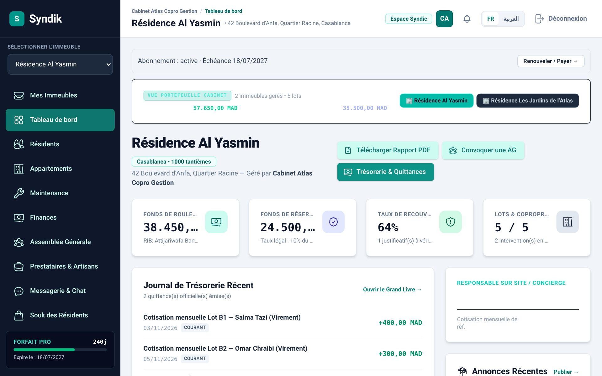
*Une fois les 5 étapes cochées, la barre de préparation disparaît et votre tableau de bord reflète la situation réelle.*

> **Conformité Maroc (Loi 18-00 / CGI) :** Réglementation marocaine de la copropriété : chaque syndicat de copropriétaires doit disposer d’un compte bancaire séparé et d’un fonds de réserve dédié aux gros travaux, distinct du budget courant.

---

## 2. Gérer les Immeubles, Coordonnées Bancaires RIB & Capacité Forfait
> **AR:** إدارة العمارات، الحساب البنكي RIB وسعة الباقة

**Catégorie :** Patrimoine & Résidences · **Durée estimée :** ~3 min

Créez vos immeubles, suivez la jauge de capacité de votre forfait SaaS, configurez le RIB bancaire et archivez ou restaurez proprement une résidence.

### Étapes pas à pas

#### Étape 1 — Ajouter une nouvelle résidence et configurer ses paramètres de base

Cliquez sur « Ajouter un immeuble », renseignez le nom, l’adresse, la ville, la cotisation syndicale mensuelle de référence, le taux d’affectation au fonds de réserve et le RIB 24 chiffres.

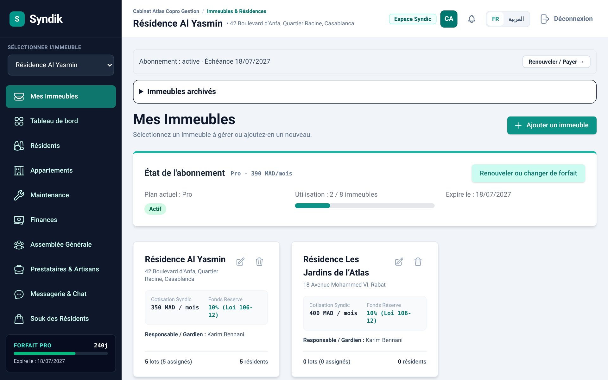
*Vue Immeubles : compteur d’utilisation du forfait, sélection active, édition RIB et accès aux immeubles archivés.*

#### Étape 2 — Archiver ou restaurer un immeuble sans perdre l’historique comptable

L’archivage libère un emplacement de votre forfait tout en conservant intégralement les archives comptables et PV. L’archivage est automatiquement bloqué si une AG est ouverte au vote ou si un justificatif bancaire attend validation.

---

## 3. Lire le Tableau de Bord & KPIs de la Résidence
> **AR:** قراءة لوحة القيادة والمؤشرات المالية والتقنية

**Catégorie :** Pilotage Quotidien · **Durée estimée :** ~2 min

Surveillez en un coup d’œil le taux de recouvrement, la trésorerie courante et de réserve, les impayés prioritaires et les tickets de maintenance ouverts.

### Étapes pas à pas

#### Étape 1 — Basculer entre vos immeubles depuis le sélecteur latéral

Dans la barre latérale gauche, utilisez le sélecteur de résidence : toutes les vues (Tableau de bord, Finances, AG, Maintenance) se synchronisent instantanément sur l’immeuble choisi.

#### Étape 2 — Exploiter les cartes KPI et raccourcis d’action rapide

Contrôlez le solde de trésorerie, les cotisations encaissées vs impayées, les demandes de paiement en attente et les incidents urgents. Cliquez sur un indicateur pour accéder directement au module correspondant.

*Tableau de bord temps réel synchronisé par SSE sur l’ensemble des postes du cabinet.*

---

## 4. Lots, Appartements & Répartition des Tantièmes (1000/1000)
> **AR:** الشقق والوحدات وتوزيع الأنصبة (1000/1000)

**Catégorie :** Patrimoine & Résidences · **Durée estimée :** ~3 min

Créez vos lots unitairement ou en masse, vérifiez l’équilibre des tantièmes de copropriété et exportez l’état descriptif de division en PDF.

### Étapes pas à pas

#### Étape 1 — Ajouter des lots ou utiliser la création en masse

Cliquez sur « Ajouter un lot » (ou « Génération en lot ») en indiquant le numéro (ex. A1, B2), l’étage, la superficie en m², les tantièmes et la cotisation mensuelle.

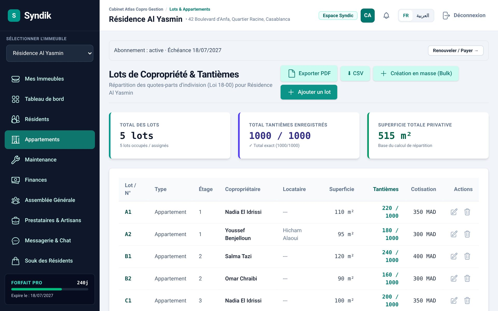
*Gestion des lots : contrôle d’équilibre 1000/1000 tantièmes, rééquilibrage automatique et export PDF.*

#### Étape 2 — Rééquilibrer les tantièmes et exporter le tableau PDF

Si la somme diffère du total de l’immeuble, utilisez l’assistant de rééquilibrage proportionnel (surface ou parts égales) ou ajustez chaque lot selon le règlement de copropriété. Cliquez sur « Exporter PDF » pour imprimer l’état des lots.

---

## 5. Résidents, Copropriétaires & Fiches d’Accès PDF
> **AR:** السكان والملاك المشتركين وبطاقات الولوج PDF

**Catégorie :** Copropriétaires & Accès · **Durée estimée :** ~3 min

Enregistrez propriétaires et locataires, liez-les à leurs lots (y compris multi-lots), générez leurs accès sécurisés et imprimez leur Fiche d’Identifiants PDF.

### Étapes pas à pas

#### Étape 1 — Ajouter un copropriétaire ou locataire et créer son compte portail

Cliquez sur « Nouveau Résident », renseignez le nom complet, l’email, le GSM, le N° CIN, la qualité (Copropriétaire Titulaire ou Locataire Occupant) et sélectionnez le ou les lots rattachés. Cochez la génération d’accès pour créer un mot de passe temporaire sécurisé.

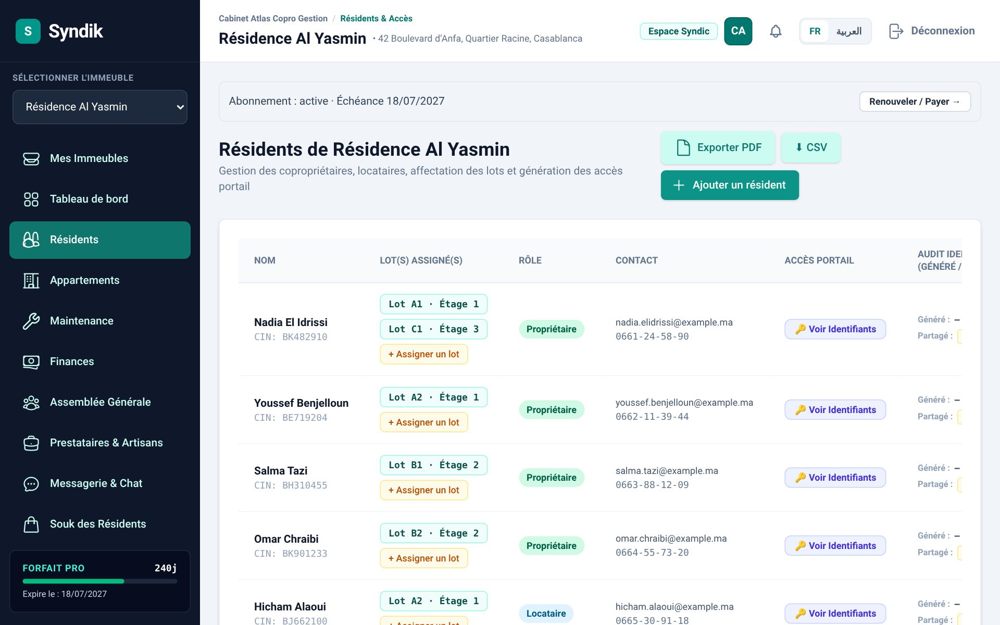
*Gestion des résidents : distinction Propriétaire / Locataire, téléchargement de la Fiche d’Accès PDF et régénération sécurisée.*

#### Étape 2 — Remettre la Fiche d’Accès PDF ou régénérer un mot de passe oublié

Cliquez sur « Fiche PDF » pour imprimer ou envoyer par WhatsApp les identifiants initiaux. Modifier une fiche résident ne réinitialise jamais son mot de passe : utilisez exclusivement le bouton dédié « Régénérer accès » en cas d’oubli.

---

## 6. Appels de Fonds, Cotisations Mensuelles & Soldes Initiaux
> **AR:** طلبات الواجبات الشهرية والأرصدة الافتتاحية

**Catégorie :** Comptabilité & Trésorerie · **Durée estimée :** ~4 min

Initialisez la reprise comptable de la copropriété, générez les appels de charges mensuels en 1 clic et encaissez un paiement direct (Espèces, Chèque, Virement).

### Étapes pas à pas

#### Étape 1 — Confirmer le solde de départ (une seule fois) et les anciens impayés

Au premier accès à « Finances », cliquez sur « Nouvel immeuble : démarrer à 0 MAD » ou sur « Saisir des soldes existants » (Compte courant + Fonds de réserve) : la bannière disparaît dès confirmation. Pour reprendre un impayé antérieur au démarrage, utilisez « Plus d'actions → Ajouter un ancien impayé ». Consultez à tout moment le récapitulatif global dans « Charges appelées → Par copropriétaire ».

#### Étape 2 — Appeler les charges du mois et encaisser un paiement

Cliquez sur « Appeler les charges du mois » en haut de Finances pour créer les montants à payer de tous les lots actifs sans doublon. Lorsqu’un copropriétaire règle ses charges, cliquez sur « Encaisser un paiement » (ou « Encaisser » sur la ligne du lot) : un résumé en clair s’affiche avant confirmation et le reçu PDF (quittance) est téléchargé instantanément.

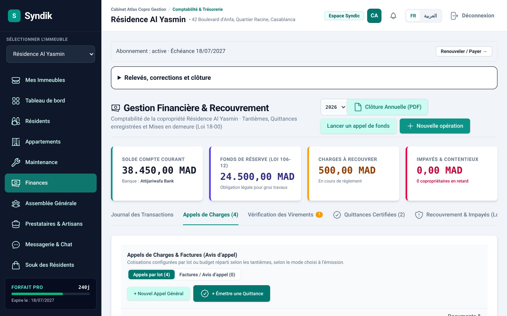
*Vue Finances simplifiée : actions rapides, panneau « À faire maintenant », suivi des charges appelées et encaissement guidé.*

---

## 7. Virements à vérifier, Rapprochement CSV & Reçus (quittances)
> **AR:** التحويلات للمراجعة، مطابقة كشف البنك CSV والوصولات (المخالصات)

**Catégorie :** Comptabilité & Trésorerie · **Durée estimée :** ~4 min

Validez les preuves de virement envoyées par les résidents, importez votre relevé bancaire CSV (Attijariwafa, BCP, CIH, BMCE…) et retrouvez tous les reçus PDF.

### Étapes pas à pas

#### Étape 1 — Contrôler et valider les virements envoyés par les copropriétaires

Ouvrez l’onglet « Virements à vérifier » (ou cliquez sur « Vérifier » dans « À faire maintenant »). Ouvrez le justificatif du résident, comparez le montant et la référence avec votre relevé, puis cliquez sur « Valider le virement » (crée automatiquement le reçu PDF dans « Reçus (quittances) ») ou « Rejeter » avec un motif. En cas de chèque rejeté ou d’erreur de saisie, cliquez directement sur « Annuler » en face du reçu dans « Reçus (quittances) ».

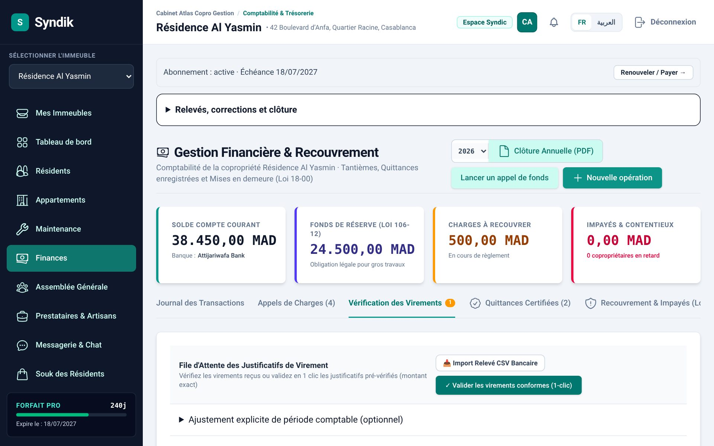
*Validation 1-clic des virements, import CSV bancaire et registre « Reçus (quittances) » téléchargeable en PDF.*

#### Étape 2 — Rapprocher un relevé bancaire CSV en lot

Importez le fichier CSV de votre banque marocaine : l’outil associe automatiquement les virements aux lots correspondants (par référence, nom ou montant) et vous laisse confirmer les écritures avant comptabilisation.

---

## 8. Enregistrer une dépense, Fonds de réserve & Historique
> **AR:** تسجيل مصروف، صندوق الاحتياط وكل السجل المالي

**Catégorie :** Comptabilité & Trésorerie · **Durée estimée :** ~3 min

Enregistrez vos factures fournisseurs (eau, électricité, gardiennage, ascenseur), gérez les virements entre fonds et exportez la clôture annuelle.

### Étapes pas à pas

#### Étape 1 — Enregistrer une dépense en quelques champs essentiels

Cliquez sur « Enregistrer une dépense » en haut de Finances. Renseignez l’essentiel (montant, catégorie, date, libellé — le fonds est pré-sélectionné selon la catégorie) ainsi que le fournisseur et le numéro de facture. Les détails facultatifs (ICE, chèque, banque, notes d’AG) restent disponibles dans « Plus de détails ».

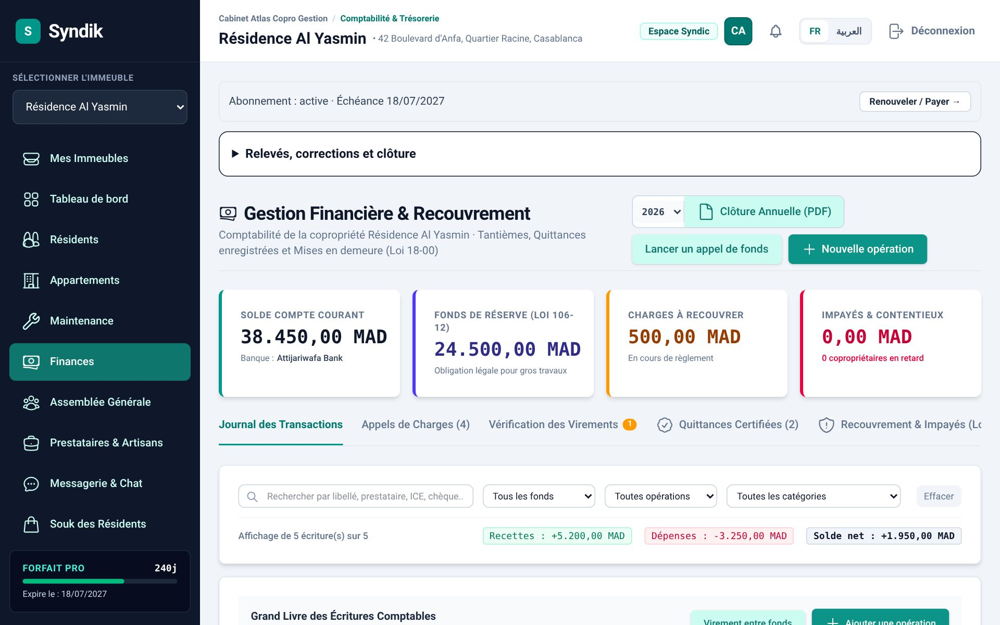
*Historique inaltérable : annulation traçable par écriture inverse en cas d’erreur, jamais de suppression silencieuse.*

#### Étape 2 — Exports Excel/CSV, verrouillage mensuel et annulation d’opération

Ouvrez le menu « Plus d'actions » pour effectuer un « Virement entre fonds », « Verrouiller un mois terminé » (protège un mois vérifié contre toute modification accidentelle), exporter vos tableaux CSV (« Exporter situation copropriétaires (CSV) » et « Exporter historique opérations (CSV) ») ou télécharger la « Clôture annuelle (PDF) ». Dans « Tout l'historique », ouvrez une opération pour télécharger son justificatif ou cliquer sur « Annuler cette dépense » / « Annuler ce paiement ».

---

## 9. Assemblées Générales (AGO/AGE), Convocations, Quorum & PV PDF
> **AR:** الجموع العامة (العادية والاستثنائية)، الاستدعاءات، النصاب والمحضر PDF

**Catégorie :** Gouvernance & AG · **Durée estimée :** ~5 min

Organisez vos Assemblées Générales conformes à la réglementation en vigueur : 1ère/2ème convocation, feuille de présence et procurations plafonnées, vote en ligne pondéré et génération du PV officiel PDF.

### Étapes pas à pas

#### Étape 1 — Planifier une AG, choisir la convocation (1ère ou 2ème) et rédiger les résolutions

Ouvrez « Assemblées Générales » et cliquez sur « Nouvelle AG ». Définissez le type (AGO ou AGE), le numéro de convocation (1ère avec quorum 50% ou 2ème sans quorum selon Art. 18), la date, puis ajoutez vos résolutions en précisant la majorité légale (Art. 21, Art. 22, Unanimité) et le budget travaux éventuel.

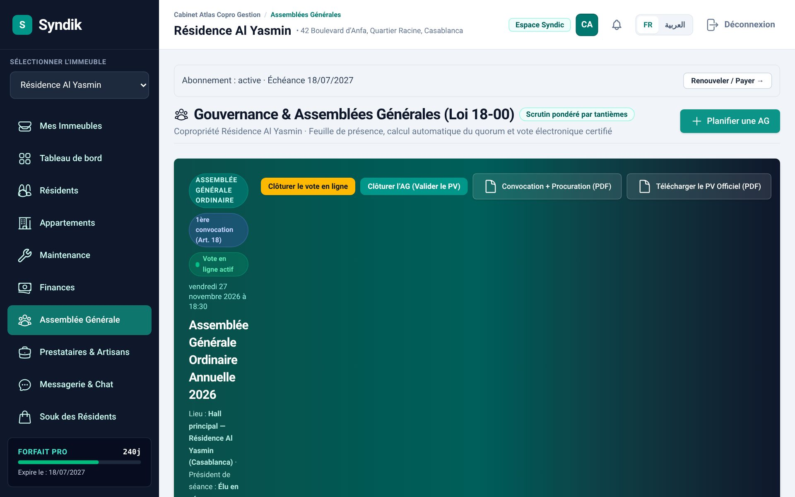
*Gouvernance complète : Convocation PDF, feuille de présence, plafond 3 procurations / 10% tantièmes et PV PDF.*

#### Étape 2 — Gérer la feuille de présence, les procurations (Art. 16-6) et ouvrir le vote

Téléchargez la « Convocation PDF » à envoyer aux copropriétaires (15 jours avant). Le jour J, pointez les présents et représentés : le système contrôle automatiquement le plafond légal (max 3 procurations et ≤ 10% des tantièmes par mandataire, syndic exclu). Ouvrez ensuite le vote en ligne.

#### Étape 3 — Clôturer l’AG, télécharger le PV officiel PDF et générer les appels travaux

Cliquez sur « Clôturer l’AG » : les résultats définitifs et réserves deviennent visibles par tous les copropriétaires, et le « PV Officiel PDF » (sans filigrane brouillon) est prêt à signer. Si une résolution travaux budgétée est adoptée, générez directement les appels de fonds répartis aux tantièmes.

> **Conformité Maroc (Loi 18-00 / CGI) :** Conformité réglementaire : les brouillons de PV avant clôture portent automatiquement un filigrane « BROUILLON » et figent les références légales à l’ouverture de la séance.

---

## 10. Suivi des Incidents, Priorités & Affectation Prestataire
> **AR:** تتبع الأعطاب، الأولويات وتعيين مقدمي الخدمات

**Catégorie :** Technique & Maintenance · **Durée estimée :** ~3 min

Centralisez les signalements des résidents et du gardien, priorisez les urgences, assignez un prestataire agréé et contrôlez la clôture des réparations.

### Étapes pas à pas

#### Étape 1 — Filtrer les incidents et affecter un prestataire agréé

Dans « Maintenance & Dépannages », ouvrez un ticket « En attente », vérifiez les photos jointes, ajustez la priorité (Basse, Moyenne, Haute, Urgence) et assignez le prestataire compétent. Celui-ci le voit immédiatement dans son portail Prestataire.

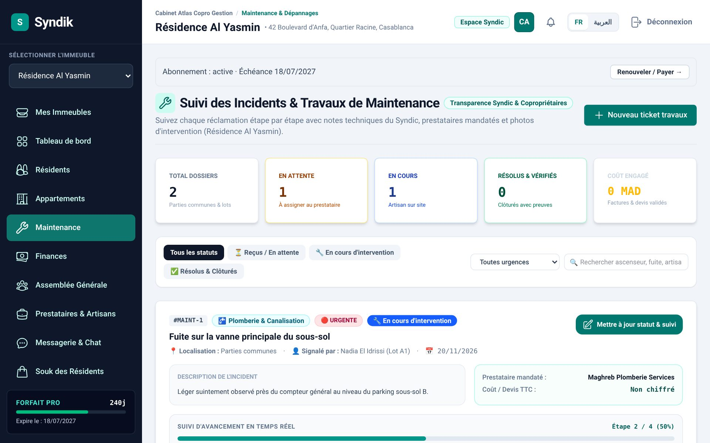
*Gestion des tickets : badges d’urgence, affectation prestataire, historique horodaté et réouverture contrôlée.*

#### Étape 2 — Vérifier la clôture ou rouvrir un ticket si l’intervention est incomplète

Une fois le ticket marqué « Terminé » par le prestataire, vérifiez son compte-rendu technique. Si une reprise est nécessaire, utilisez le bouton « Rouvrir » (réservé au Syndic).

---

## 11. Annuaire Prestataires Agréés (ICE/RC/RIB) & Fiches d’Accès
> **AR:** دليل مقدمي الخدمات المعتمدين (ICE/RC/RIB) وبطاقات الولوج

**Catégorie :** Technique & Maintenance · **Durée estimée :** ~3 min

Référencez vos partenaires techniques avec leurs identifiants légaux marocains, générez leurs accès portail et suspendez instantanément un contrat résilié.

### Étapes pas à pas

#### Étape 1 — Ajouter un prestataire avec ICE, RC, spécialité et accès portail

Dans « Prestataires & Contrats », cliquez sur « Ajouter un prestataire », renseignez la raison sociale, le responsable, le téléphone d’astreinte, la spécialité, l’ICE et le RC, puis activez la création d’accès portail.

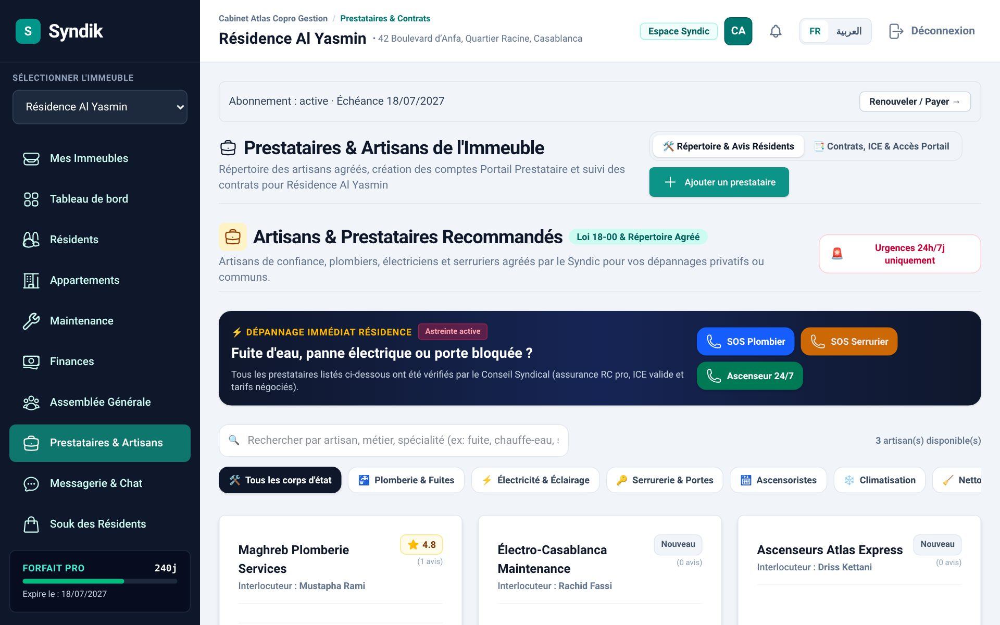
*Fiches prestataires complètes : spécialités, coordonnées légales, notes des résidents et Fiche d’Accès PDF.*

#### Étape 2 — Télécharger la Fiche d’Accès PDF ou désactiver un compte

Remettez la « Fiche PDF » à votre partenaire. Si vous cessez de travailler avec un prestataire, passez son statut en inactif ou archivez-le : sa session est immédiatement révoquée et ses tickets ouverts sont désassignés.

---

## 12. Coffre-fort Documents & Contrôle de Visibilité
> **AR:** أرشيف الوثائق وضبط صلاحيات الاطلاع

**Catégorie :** Archives & Communication · **Durée estimée :** ~2 min

Classez vos contrats, assurances, règlements et PV en choisissant précisément qui peut les consulter (Tous les résidents, Propriétaires uniquement ou Syndic uniquement).

### Étapes pas à pas

#### Étape 1 — Téléverser un document et définir son niveau de confidentialité

Dans « Archives & Documents », choisissez la catégorie, sélectionnez la visibilité (« Tous les résidents », « Copropriétaires uniquement » ou « Syndic uniquement ») puis importez votre fichier PDF ou image (max 5 Mo).

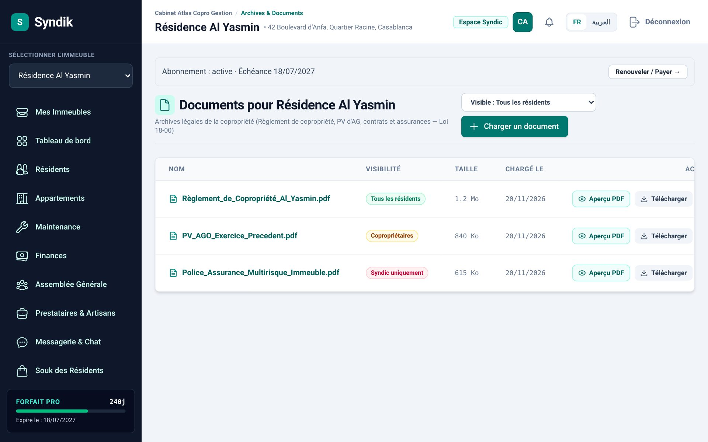
*Stockage sécurisé authentifié : chaque fichier supprimé est immédiatement inaccessible et purgé.*

---

## 13. Annonces Officielles & Modération de la Messagerie
> **AR:** الإعلانات الرسمية وإشراف المحادثات الجماعية

**Catégorie :** Archives & Communication · **Durée estimée :** ~2 min

Diffusez les avis importants (coupure d’eau, entretien ascenseur, convocation AG) avec priorité Normale ou Urgente, et modérez la messagerie interne de la résidence.

### Étapes pas à pas

#### Étape 1 — Publier une annonce officielle (Normale ou Urgente)

Dans « Annonces Officielles », saisissez le titre, le message et choisissez la priorité (« Urgente » affiche un bandeau d’alerte rouge visible immédiatement sur le portail de tous les habitants et génère une notification).

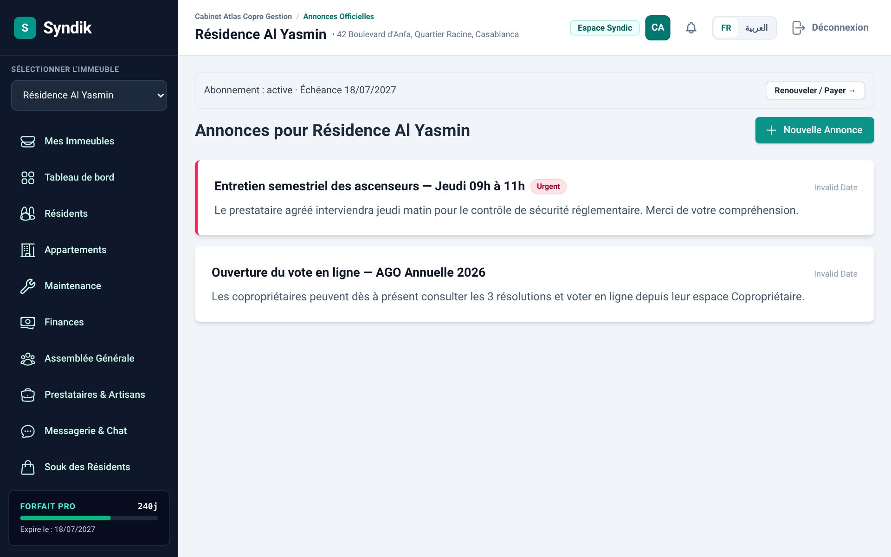
*Diffusion instantanée aux résidents avec horodatage et gestion des priorités.*

#### Étape 2 — Participer et modérer la Messagerie Communautaire

Dans « Messagerie », répondez directement aux questions des habitants dans les canaux thématiques et supprimez tout message inapproprié grâce au bouton de modération Syndic.

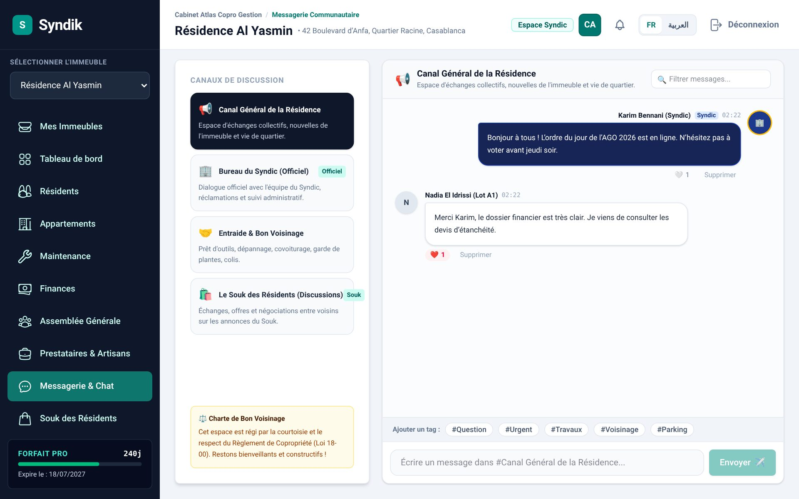
*Canaux séparés (Général, Entraide, Alertes) et modération directe par le Syndic.*

---

## 14. Modérer Le Souk de la Résidence
> **AR:** إدارة ومراقبة سوق الإقامة

**Catégorie :** Archives & Communication · **Durée estimée :** ~2 min

Supervisez les petites annonces publiées entre voisins, échangez en message privé avec un annonceur ou retirez une annonce non conforme.

### Étapes pas à pas

#### Étape 1 — Consulter les annonces actives et modérer si besoin

Dans « Souk des Résidents », filtrez les annonces par catégorie ou statut. En tant que Syndic gestionnaire, vous pouvez clôturer ou supprimer une annonce inappropriée (les fils privés associés sont purgés proprement).

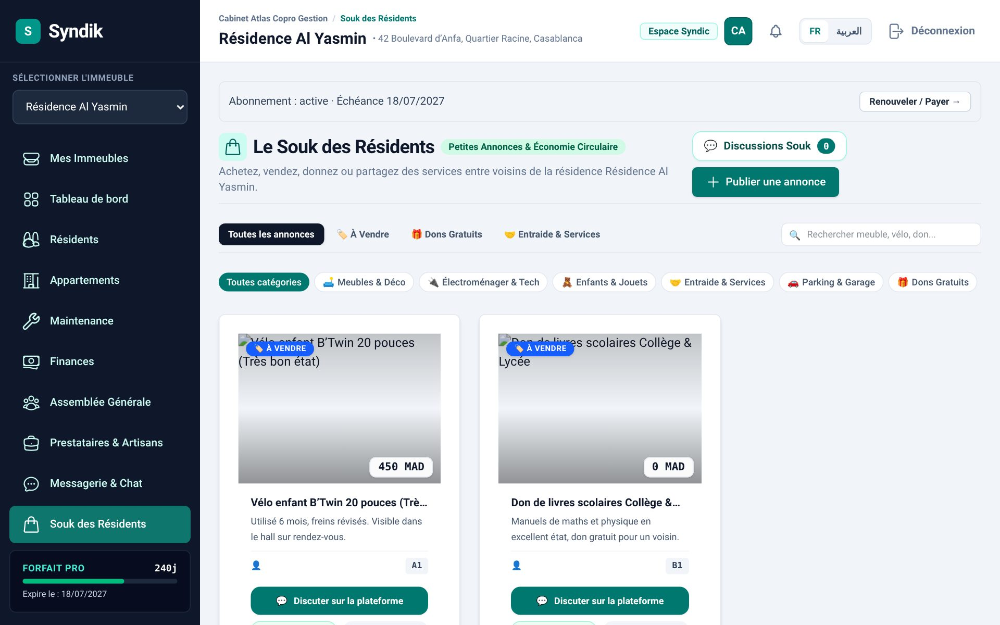
*Modération bienveillante du Souk interne de la copropriété.*

---

## 15. Paramètres Cabinet, Rapports & Renouvellement SaaS (CMI, PayPal, RIB, Espèces & Factures PDF)
> **AR:** إعدادات المكتب، التقارير وتجديد الاشتراك (CMI، PayPal، RIB، نقداً والفواتير PDF)

**Catégorie :** Cabinet & Abonnement SaaS · **Durée estimée :** ~4 min

Personnalisez les mentions légales de votre cabinet (Logo, ICE, RC, IF, Patente), analysez vos rapports et renouvelez votre abonnement par CMI Maroc, PayPal, Virement RIB ou Espèces/Agences avec téléchargement de vos Factures PDF.

### Étapes pas à pas

#### Étape 1 — Mettre à jour la fiche fiscale du cabinet et le logo (imprimés sur vos PDF)

Ouvrez « Paramètres du Cabinet » pour saisir votre raison sociale, ICE, Identifiant Fiscal, RC, Patente et importer le logo du cabinet. Ces informations figurent sur toutes vos Quittances, Convocations et PV d’AG.

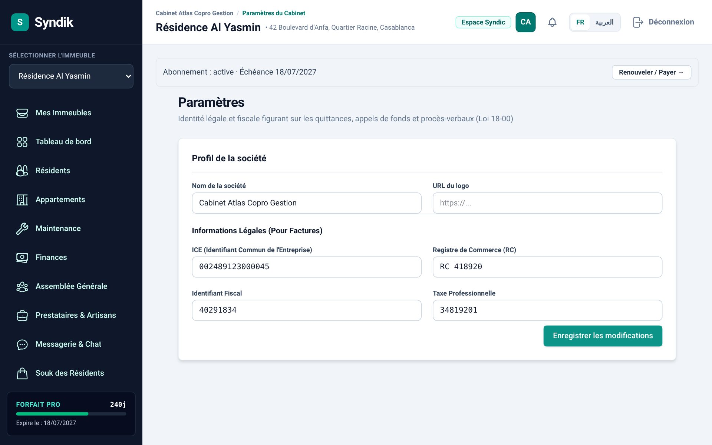
*Paramètres protégés contre l’écrasement lors des synchronisations temps réel.*

#### Étape 2 — Renouveler votre abonnement (CMI Maroc 3DS, PayPal, Virement RIB ou Espèces/Agences)

Cliquez sur « Renouveler / Payer → » dans le bandeau supérieur ou dans le pied de la barre latérale. Choisissez votre forfait et durée (remises multi-mois 3/6/12m affichées en direct), appliquez un éventuel Code Promo puis réglez via l’onglet de votre choix : Carte Marocaine CMI (redirection 3D Secure), PayPal/Carte Internationale, Virement RIB Maroc ou Espèces/Wafacash/Cash Plus/Barid Cash/Chèque.

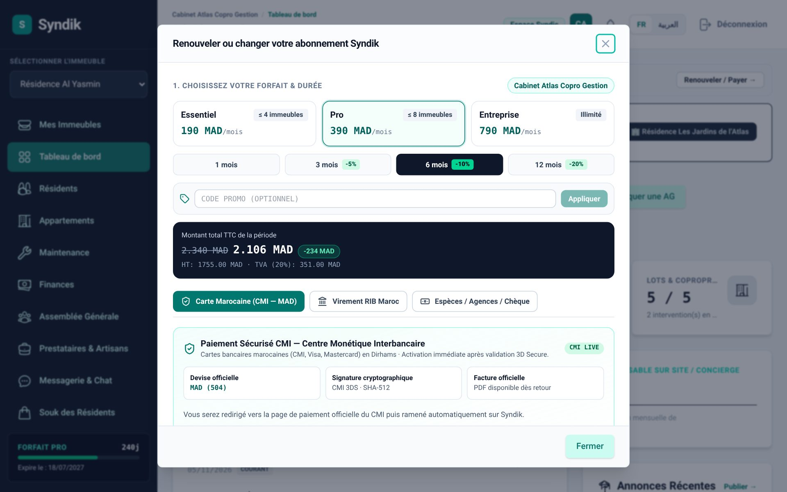
*Paiement multi-passerelles Maroc + section « Mes Factures & Reçus Officiels » avec téléchargement PDF immédiat.*

#### Étape 3 — Télécharger vos Factures & Reçus Officiels PDF

En bas de la fenêtre de renouvellement, retrouvez toutes vos demandes hors-ligne en cours ainsi que la liste de vos paiements confirmés avec bouton « Facture PDF » comportant ICE, HT, TVA et TTC.

---
